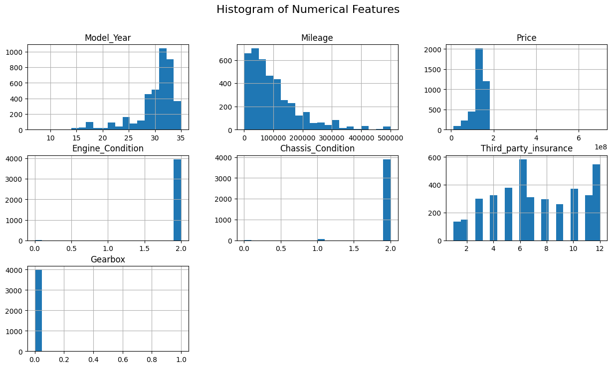
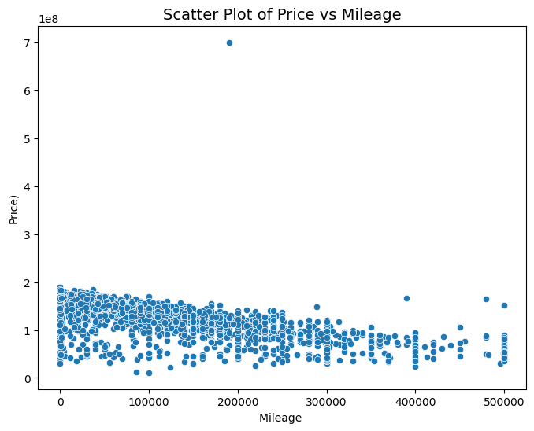

# Used-Car Price Prediction: Linear, Ridge and Lasso Regression from Scratch

Linear, ridge and lasso regression **implemented from scratch in NumPy** and benchmarked against scikit-learn, applied to roughly 4,000 used-car listings from Divar, Iran's largest classifieds platform. The project covers the full workflow: cleaning raw listings, exploratory analysis, feature preparation, model fitting and evaluation.

<p align="center">
  
  
</p>

## Pipeline

| Stage | Content |
|---|---|
| **Cleaning** | Missing values, type conversion, encoding of categorical attributes (gearbox, engine and chassis condition, insurance) |
| **Exploration** | Distributions, outliers and bivariate relationships between price, mileage and model year |
| **Models** | A custom NumPy estimator: closed-form OLS and ridge, lasso by gradient descent on the L1-penalised loss; scikit-learn counterparts as a benchmark |
| **Evaluation** | Train and test RMSE; inspection of lasso coefficient shrinkage |

## Results

Test-set error of the benchmark (scikit-learn) models:

| Model | Test RMSE |
|---|---|
| Linear regression | 10.13 M |
| Ridge | **9.45 M** |
| Lasso | 9.46 M |

Regularisation reduces out-of-sample error by about 7% relative to unregularised least squares, with ridge and lasso performing almost identically on this feature set.

## Repository structure

```
car_price_regression.ipynb   # cleaning → EDA → models from scratch → evaluation
figures/                     # selected figures exported from the notebook
```

## Reproducing

Data: [Divar cars dataset on Kaggle](https://www.kaggle.com/datasets/arianghasemi/divar-cars/data).

```bash
pip install numpy pandas matplotlib seaborn scikit-learn
```

Some explanatory text in the notebook is in Persian; code, equations and outputs follow standard conventions.

## Context

Developed for the graduate Machine Learning course at Sharif University of Technology (2025).

---
**Shayan Pourmasoomi** · MSc Economics, Sharif University of Technology · [LinkedIn](https://www.linkedin.com/in/shayan-pourmasoomi-8b6206389)
